# Buffet Terror

Juego de terror psicológico ambientado en el buffet de un colegio, llamado "El Buffet". Atendés clientes, hacés tareas y cuidás tu cordura.
Proyecto Integrador de Laboratorio de Programación Orientada a Objetos (Ejercitación 16: escalado a interfaz gráfica).

- Integrantes: Toledano Jazmín y Octavio Pagni
- Tecnología gráfica: Java Swing + FlatLaf (Maven)
- Base de datos: MySQL

# Requisitos

- JDK 17 o superior
- Maven 3.8+
- MySQL 8 (o MariaDB) corriendo en `localhost:3306`

# Puesta en marcha

1. Instalá **JDK 17 o superior** y **Maven 3.8+**.
2. Tené **MySQL 8** (o MariaDB) corriendo en `localhost:3306`.
3. Creá la base ejecutando el script:

   ```bash
   mysql -u root -p < sql/schema.sql
   ```

   El script crea `buffet_terror`, la tabla `entidades` y una partida de ejemplo.
4. Copiá `config.example.properties` como `config.properties` y completá usuario/clave si hace falta. Ese archivo está en `.gitignore` y no se sube al repositorio.
5. Compilá y ejecutá con Maven desde la raíz del proyecto:

   ```bash
   mvn clean compile
   mvn compile exec:java
   ```

   También podés abrir `pom.xml` en el IDE y ejecutar `main.Main`.
6. Si querés un `.jar` ejecutable: `mvn package` y después `java -jar target/buffet-juego-1.0.0.jar` (parado en la raíz para que encuentre `config.properties`).

# Cómo se juega

1. En el menú pixel art, elegí una partida guardada y entrá con `ENTER` (o doble clic). También podés crear una nueva, editarla o borrarla sin salir del lienzo:
   - `↑ ↓` / `W S`: mover la selección.
   - `ENTER`: jugar la partida elegida.
   - `N`: nueva partida. `E`: editar la elegida. `SUPR`: borrar (con confirmación).
   - `R` o `F5`: volver a leer las partidas desde MySQL.
   - En el formulario: `TAB` cambia de campo, `ENTER` guarda y `ESC` cancela.
2. Controlás al personaje en un plano 2D del buffet:
   - Moverte: `W A S D` o las flechas.
   - Interactuar: `E` (o `Enter` / `Espacio`) cuando aparece el cartel sobre el personaje.
   - Soltar lo que tenés en la mano: `Q`.
   - Mochila rápida: `I` (usa el primer consumible; si no hay, equipa la primera herramienta).
   - Cuaderno de turno: `TAB` (pedidos, tareas pendientes e inventario).
   - Pausa: `ESC` (continuar, guardar o salir al menú).
3. **Cuatro salas conectadas por puertas.** Caminá hasta el borde de la pantalla para cruzar:
   - **Comedor** ↔ **Baño** por la puerta izquierda.
   - **Comedor** ↔ **Cocina** por la puerta derecha.
   - **Cocina** ↔ **Almacén** por la puerta de abajo.
   Cada cambio de sala hace un fundido a negro y te deja del otro lado.
4. **Los pedidos se llevan en la mano**, no se resuelven con un botón:
   1. En el mostrador del comedor, `E` para **tomar el pedido** del cliente que está esperando.
   2. Andá a la cocina y `E` en la mesada para **preparar la bandeja**.
   3. Volvé al mostrador con la bandeja y `E` para **entregarla**. Solo la bandeja correcta sirve. Entregar suma **+6 de cordura** (neto **+5** por el desgaste de la interacción).
   4. Si tenés las manos ocupadas con una herramienta, soltala con `Q` antes de preparar.
5. **Las tareas piden una herramienta concreta**, que hay que buscar físicamente en el almacén:

   | Lugar de la tarea | Herramienta |
   | --- | --- |
   | Baño | trapeador |
   | Mesas del comedor | esponja |
   | Basura | escoba |
   | Tablero de luz | fusible |
   | Plancha | espátula |
   | Cafetera | llave inglesa |
   | Heladera | guantes de goma |

   La herramienta **no se gasta**: queda en la mano y podés llevarla de una tarea a otra. Si agarrás otra, la anterior se guarda en la mochila. Completar una tarea suma **+4 de cordura** (neto **+3** por el desgaste) y puede dejar un objeto de recompensa.
6. **Una sola cosa en la mano.** Podés llevar una bandeja o una herramienta, nunca las dos. `Q` suelta lo que tenés: las herramientas vuelven a la mochila y las bandejas se tiran (**−2 de cordura**).
7. **La mochila** guarda las recompensas de las tareas. Abrila con `TAB` y movete con `↑↓`:
   - Los consumibles (café, gaseosa, jabón, propina, nota) cambian la cordura y desaparecen.
   - Las herramientas se equipan en la mano.
8. **La cordura es el reloj de la partida:**
   - Cada interacción descuenta **−1**; mientras el tablero de luz esté roto, descuenta **−2**.
   - Si llega a **0**, perdés en el acto.
   - Al cerrar la jornada, si terminás con **menos de 30**, la noche te gana y perdés la partida.
   - Al pasar al día siguiente recuperás **+8**.
   - Cuanta menos cordura, más oscura se ve la sala, más parpadean las luces y más cosas raras aparecen.
9. **Los días escalan.** El día 1 tiene **5 clientes y 4 tareas**. Cada día siguiente suma un cliente y una tarea (hasta 12 y 7), y las tareas se reparten en lugares distintos. Cuando atendés a todos y terminás todas las tareas, se habilita **Cerrar la jornada**.
10. El progreso se guarda en MySQL al pasar de día, al guardar desde la pausa y al cerrar la ventana. Salir desde la pausa te deja elegir si querés guardar.
11. Desde el menú podés editar el nombre/día de una partida o eliminarla.

# Interfaz pixel art

Todo el juego —el menú de partidas, el buffet, el HUD, los diálogos, el cuaderno y la intro— se dibuja dentro del mismo **lienzo de 384x240 píxeles** y después se escala por un factor entero (hasta 4x en 1920x1080, 2x en pantallas chicas) con *nearest neighbor*, así ningún píxel queda deformado ni borroso. No hay paneles de Swing alrededor del juego: el estado, la bitácora, el menú y los formularios son parte de la misma escena.

- **Menú de partidas pixel art con JTable real:** la lista es un `JTable` con `DefaultTableModel` que carga las partidas persistidas al abrir y se refresca después de cada alta, modificación o baja. La tabla se pinta dentro del lienzo junto con la ficha del jugador, los botones de jugar/nueva/editar/borrar y el formulario de alta o edición.
- **Intro de cinco pasos:** cartel de "BUFFET TERROR" que parpadea, tres noches con texto a máquina y una última pantalla con los controles. Se avanza con `ENTER` y se sale con `ESC`.
- **HUD dentro del lienzo:** día y sala, pedidos y tareas, barra de cordura, objeto en mano, objetivo del turno y las dos últimas entradas de la bitácora. El cartel de interacción aparece sobre la cabeza del personaje.
- **Cuaderno (`TAB`):** pedido actual, tareas pendientes con su lugar y herramienta, e inventario navegable con `↑↓` + `ENTER`.
- **Pausa (`ESC`):** continuar, guardar progreso o salir al menú con confirmación.
- **Fin de jornada:** resumen de clientes, tareas y cordura, uso de consumibles y confirmación extra si el jugador está por debajo del mínimo de cordura.
- **Derrota:** pantalla propia con la causa; no se guarda, así se retoma la última partida guardada.
- El arte se dibuja a mano con rectángulos de píxeles (elipses por filas, luces con tramado, partículas) y la tipografía es [Silkscreen](https://fonts.google.com/specimen/Silkscreen) (SIL Open Font License), incluida en `src/main/resources/fonts/`.
- En Windows con escalado fraccionario (125 %, 150 %), `Main` fuerza `sun.java2d.uiScale=1.0` para que el zoom del sistema no arruine la nitidez del pixel art.

# Contenido del repositorio

- `pom.xml`: proyecto Maven con Java 17, MySQL Connector/J, FlatLaf y `exec-maven-plugin`.
- `src/main/java`: código fuente por capas (`modelo`, `dao`, `service`, `excepciones`, `ui`, `main`).
- `src/main/resources/fonts`: tipografía pixel art Silkscreen.
- `sql/schema.sql`: crea la base `buffet_terror`, la tabla `entidades` y una partida de ejemplo.
- `docs/`: capturas de la ventana principal, el registro exitoso y los cuadros de error.
- `config.example.properties`: plantilla de conexión (el `config.properties` real va en `.gitignore`).
- `.gitignore`: excluye `target/`, archivos de IDE, credenciales y la carpeta de referencia de consola.

# Arquitectura en capas

src/main/java
---------------------
├── ui/            Ventana, menú de partidas, escena pixel art de las cuatro salas (EscenaBuffet + Pixel, Java2D), pantalla de juego completa (intro, HUD, cuaderno, pausa) y tema FlatLaf. Sin reglas de negocio ni SQL.         
|
├── service/       PartidaService (alta/baja/modificación/consulta y persistencia) y JuegoService (reglas del juego: pedidos, bandejas, herramientas, salas, cordura y días). Lanzan las excepciones.         
|
├── dao/           EntidadDAO / JugadorDAO / Conexion: CRUD sobre MySQL.      
|
├── modelo/        Mundo → Personaje → Jugador, Cliente, NPC; Objeto → Herramienta; Tarea, Lugar, Sala, Inventario.      
|
├── interfaces/    Interactuable      
|
├── excepciones/   Las 5 excepciones del juego + PersistenciaException (fallas de base de datos)
│
└── main/          Main: abre la ventana

Flujo: Usuario → UI → Service → DAO → MySQL. Las excepciones viajan del Service a la UI, que las muestra con `JOptionPane` (y además deja el aviso en el HUD), sin cortar la partida.

# Flujo de trabajo

El repositorio se trabajó con una rama por integrante (`jazmin` y `octavio`) y la integración final en `main` mediante merges. La entrega no incluye versiones anteriores ni carpetas duplicadas: el proyecto Maven está directamente en la raíz.

# Capturas

Las pantallas del juego están renderizadas a 3x (1152x720) desde el lienzo de 384x240. El menú de partidas usa el mismo escalado entero y se capturó a 4x (1536x960), el tamaño máximo en 1920x1080.

| | |
| --- | --- |
| 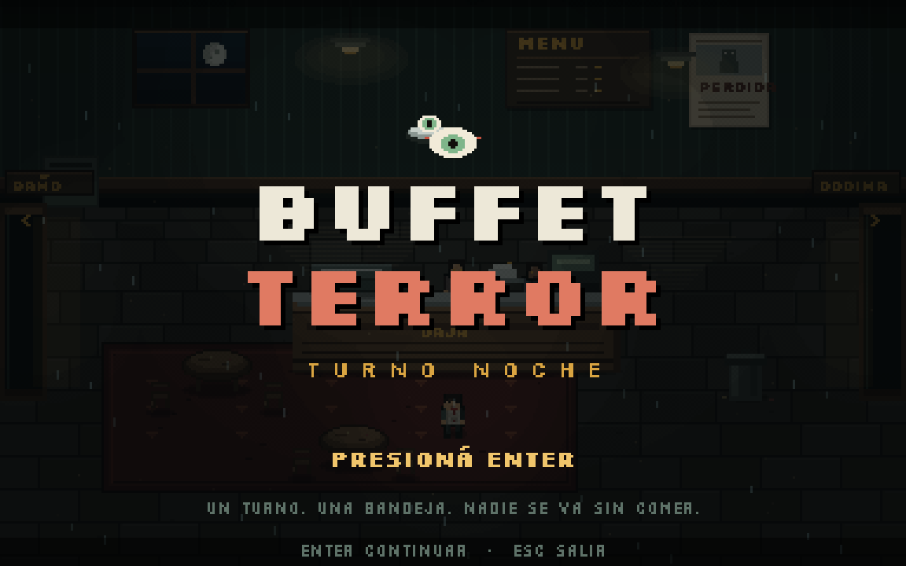 | 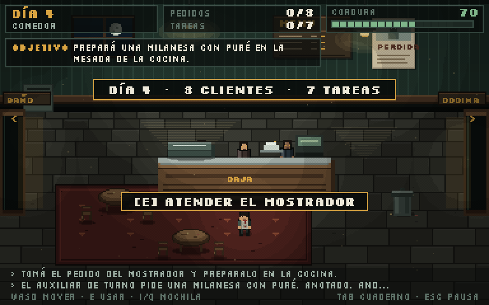 |
| 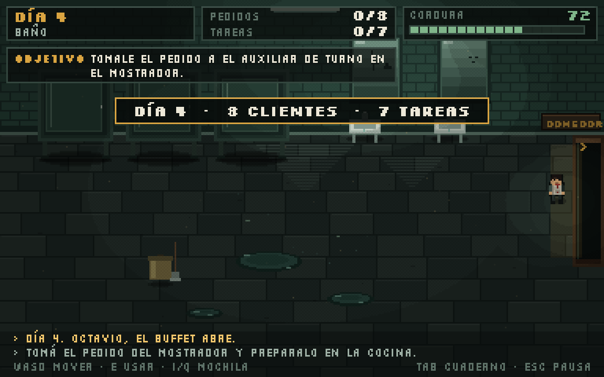 | 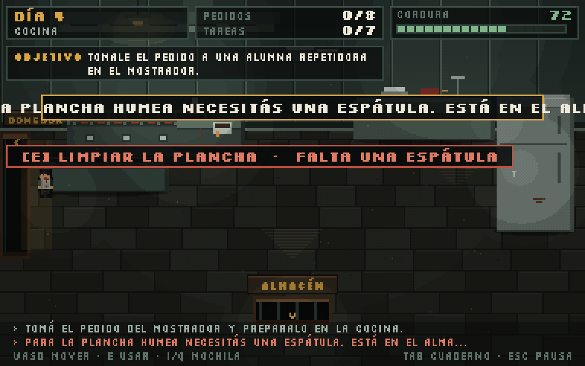 |
| 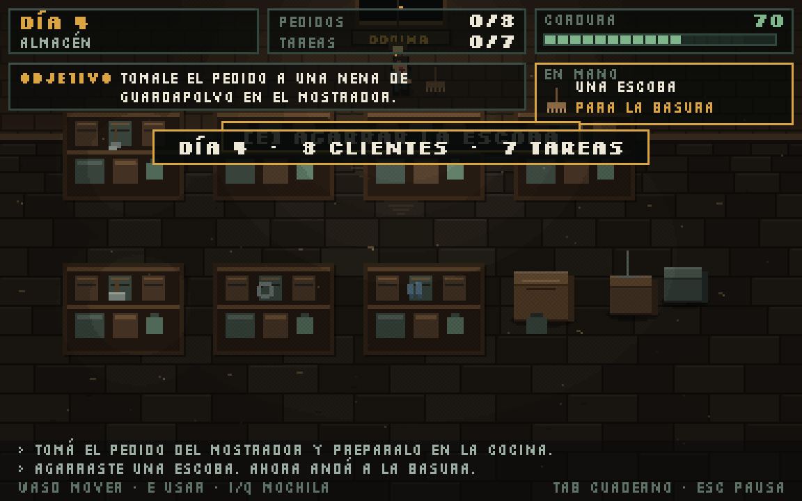 | 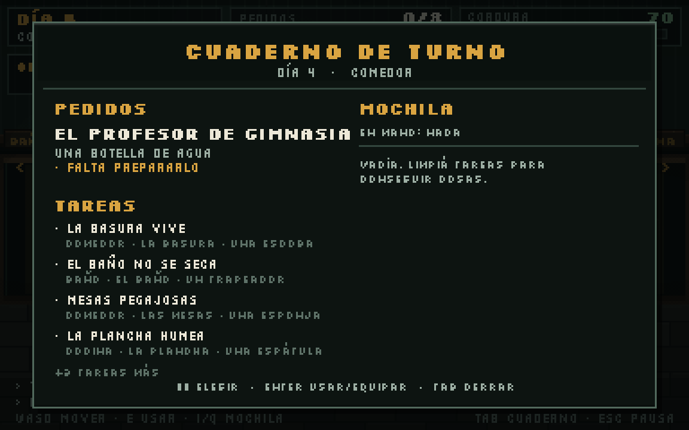 |
| 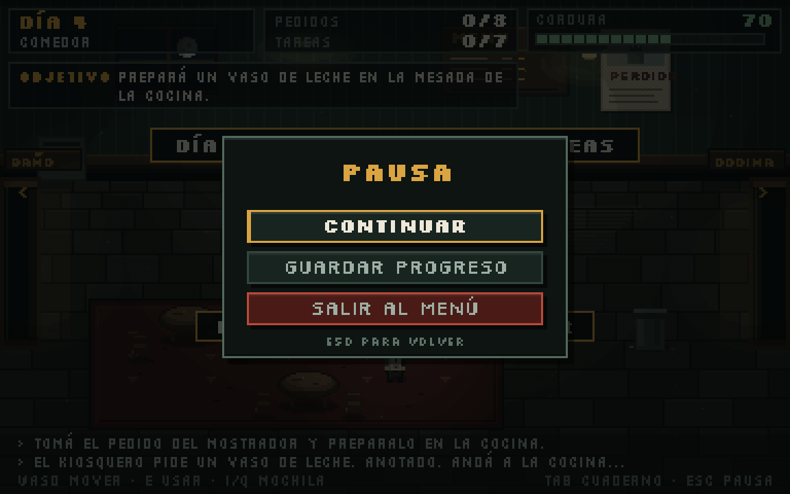 | 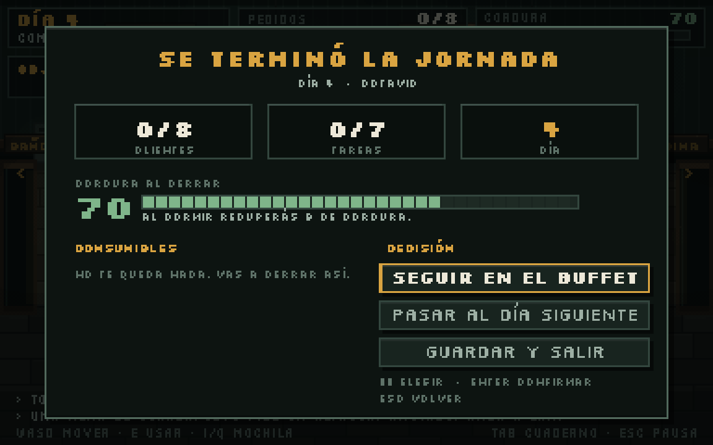 |
| 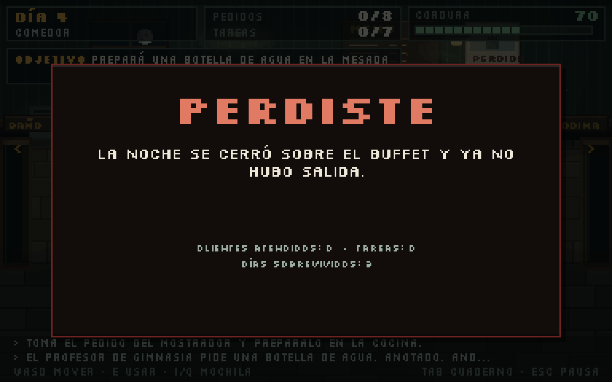 | 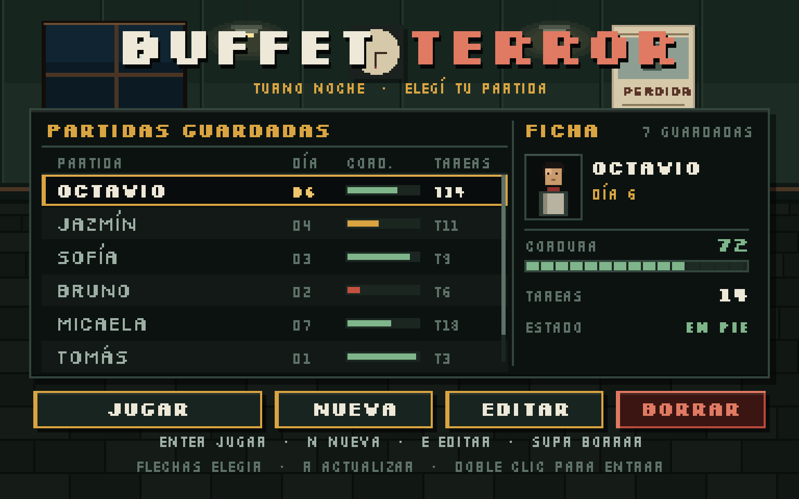 |
| 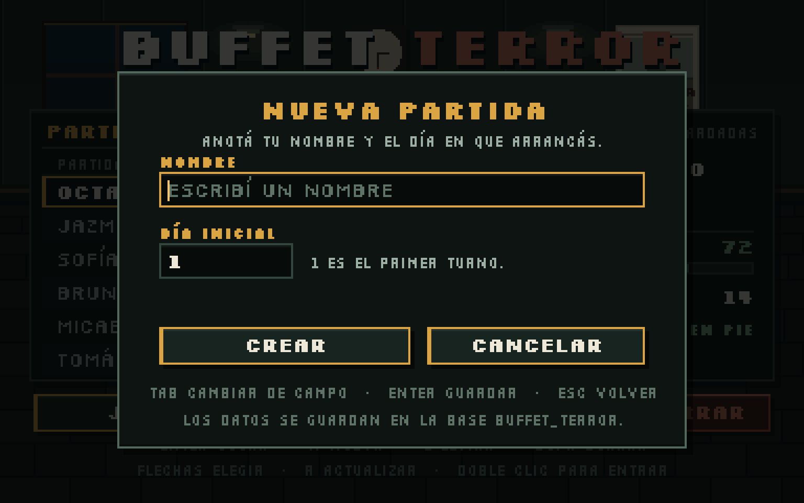 | 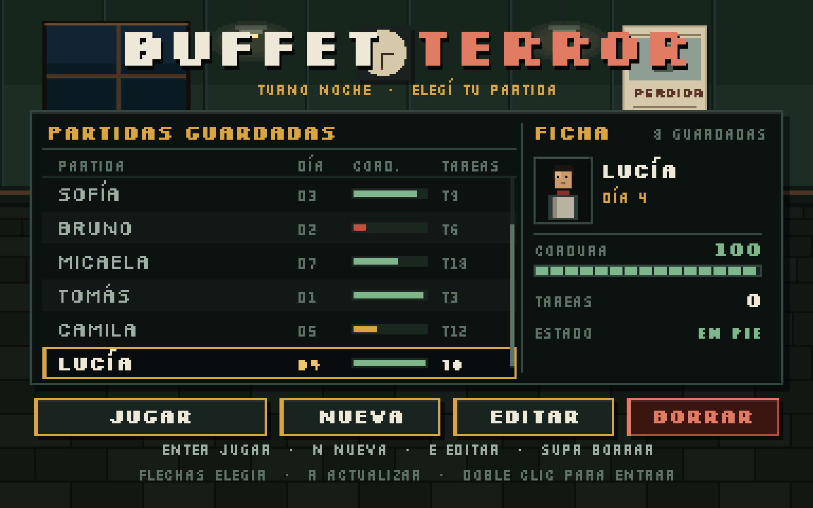 |
| 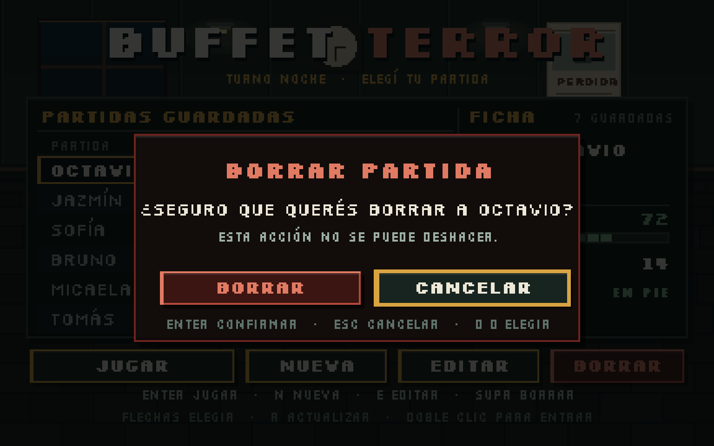 | 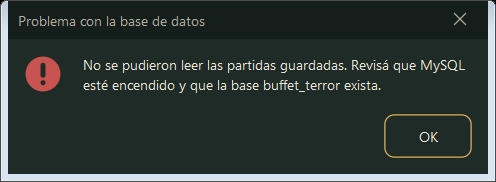 |
